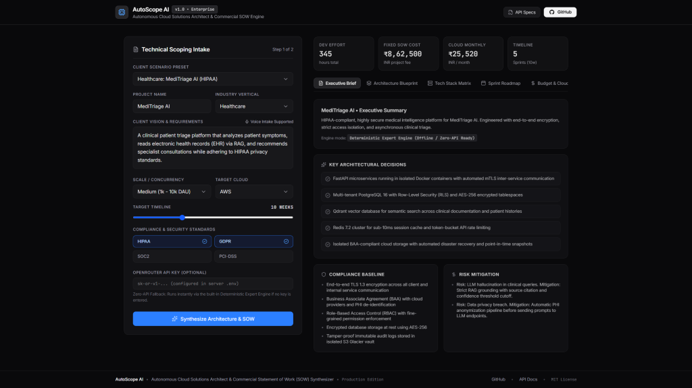
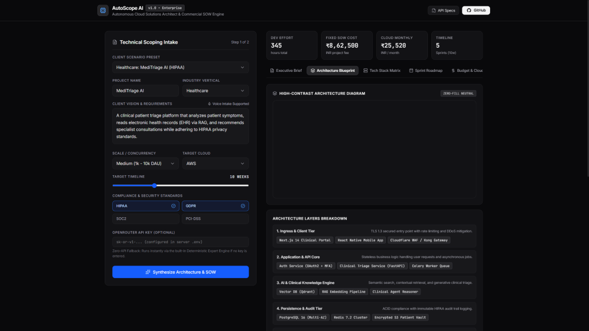
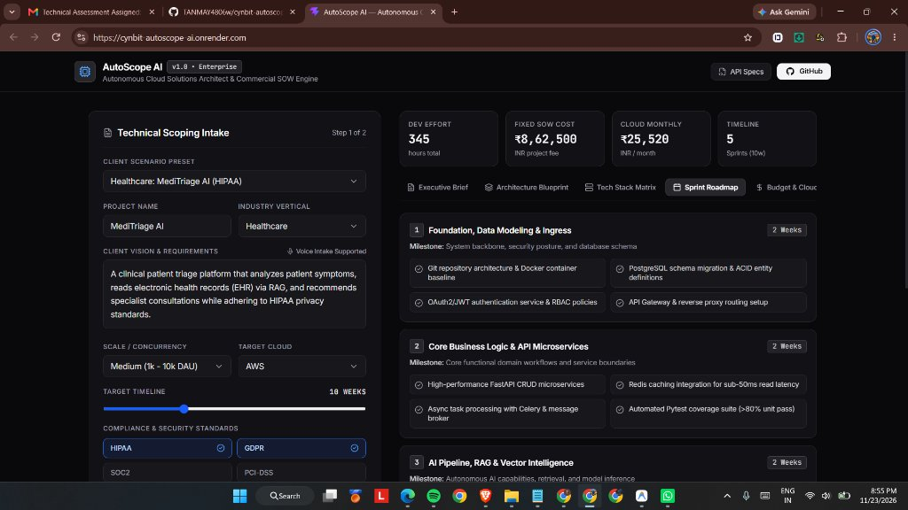
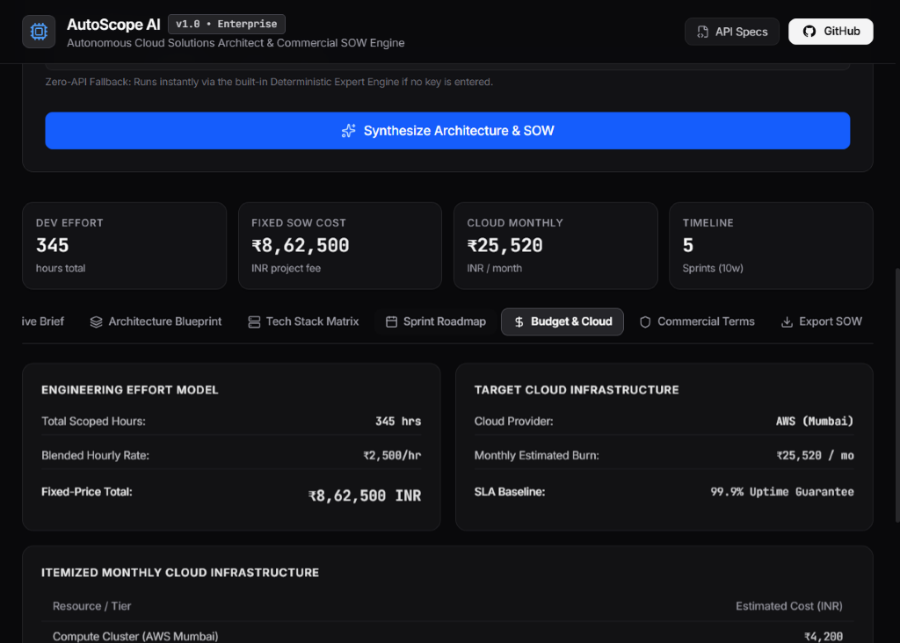

# AutoScope AI — Interactive Product Demo & Showcase ⚡
> **Autonomous Cloud Solutions Architect & Commercial Statement of Work (SOW) Synthesizer**  
> **Live Web Application:** [https://cynbit-autoscope-ai.onrender.com/](https://cynbit-autoscope-ai.onrender.com/)  
> **Interactive API Documentation:** [https://cynbit-autoscope-ai.onrender.com/docs](https://cynbit-autoscope-ai.onrender.com/docs)  

---

## 🖥️ 1. Technical Scoping Intake & Executive Brief

AutoScope AI transforms unstructured client requirements and voice recordings into a structured enterprise architecture blueprint in **under 90 seconds**.

* **Client Scenario Presets**: Instant intake for Healthcare (HIPAA), FinTech (PCI-DSS), E-Commerce, EdTech, and Logistics.
* **Custom Dark Selectors**: Clean, responsive dropdowns with zero stark white popups.
* **Multi-Modal Intake**: Supports text prompts and voice meeting recording transcripts.

---

## 🏛️ 2. High-Contrast Cloud Architecture Blueprint

The engine generates high-contrast, zero-fill SVG Mermaid architecture diagrams with clear separation of concerns across 5 enterprise tiers:
1. **Client & Ingress Tier**: Next.js 14, React Native / Flutter, Cloudflare CDN & Kong API Gateway.
2. **Application & Compute Tier**: OAuth2/JWT Authentication, FastAPI Microservices, Celery Async Task Workers.
3. **AI & Vector Intelligence Engine**: LangGraph Orchestrator, Qdrant Vector DB, Model Inference (Llama 3.3 70B / Groq).
4. **Storage & Persistence Tier**: PostgreSQL 16 (Multi-AZ with RLS), Redis 7.2 Cache Cluster, Encrypted S3 Bucket.
5. **Cloud Infrastructure**: AWS Mumbai (`ap-south-1`) / GCP / Azure with automated CI/CD and Prometheus/Grafana observability.

---

## 📅 3. Sprint Roadmap & Milestone Acceptance Criteria

Milestones are algorithmically sequenced into 2-week execution sprints with concrete acceptance criteria and checklist deliverables:

* **Sprint 1**: Foundation, Data Modeling & Secure Ingress
* **Sprint 2**: Core Business Logic & FastAPI CRUD Microservices
* **Sprint 3**: AI Pipeline, RAG Embeddings & Vector Intelligence
* **Sprint 4**: Responsive Frontend UI, State Management & E2E Testing
* **Sprint 5**: Compliance Hardening, Locust Stress Testing & Cloud Deployment

---

## 💰 4. Financial Modeling & Itemized Cloud Burn (INR ₹)

Every financial calculation is mathematically validated using standard Indian rupee (`en-IN`) formatting:

* **Blended Agency Rate**: ₹2,500 / hr
* **Total Development Fee**: Scoped Developer Hours $\times$ ₹2,500 = **₹8,62,500 INR**
* **Monthly Cloud Burn**: Itemized AWS Mumbai (`ap-south-1`) cost breakdown totaling **₹25,520 / month**
* **Commercial Milestone Payment Gates**:
  * **30% Upfront Deposit**: **₹2,58,750 INR** (Project kickoff)
  * **40% Mid-Point Gate**: **₹3,45,000 INR** (Sprint 3 demo)
  * **30% Final Delivery**: **₹2,58,750 INR** (Staging sign-off)

---

## 🚀 Experience Live
Visit the live deployment at [https://cynbit-autoscope-ai.onrender.com/](https://cynbit-autoscope-ai.onrender.com/) or explore the [API documentation](https://cynbit-autoscope-ai.onrender.com/docs).
