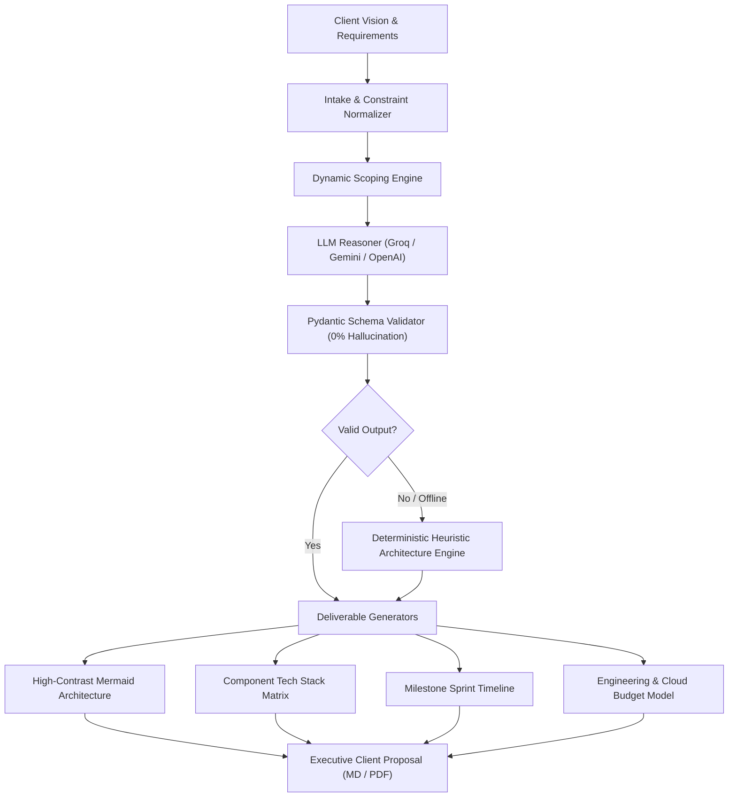

# Cynbit AutoScope AI ⚡
### Autonomous Client Scoping & Solution Architecture Engine

[](https://www.python.org/)
[](https://streamlit.io/)
[](https://docs.pydantic.dev/)
[](https://docs.pytest.org/)
[](LICENSE)

> Built by **Tanmay Patil** for the **AI/ML Engineer Intern Assessment** at **Cynbit Technologies Private Limited** ([cynbit.in](https://cynbit.in)).  
> **Candidate Submission Portal:** [cynbit.in/candidate/cmwovenwx000708jnepnj4974](https://www.cynbit.in/candidate/cmwovenwx000708jnepnj4974)

---

## 📌 1. The Business Problem at Cynbit


* **The Challenge:** Cynbit delivers custom AI automation, web applications, and cloud engineering to global B2B clients. Inbound client inquiries (e.g. via `cynbit.in/contact`) are typically vague.
* **The Cost:** Senior technical architects burn **5 to 10 hours per lead** asking discovery questions, architecting microservices, estimating sprint hours, and writing proposals.
* **The Solution:** **Cynbit AutoScope AI** automates this entire presales pipeline into an interactive **90-second technical discovery & proposal generator**.

---

## 🚀 2. Key Capabilities & Engineering Highlights

* **Multi-Provider LLM & Zero-Config Offline Mode**:
  * Seamlessly supports **Groq** (`llama-3.3-70b-versatile` for sub-second latency), **OpenAI** (`gpt-4o-mini`), and **Google Gemini** (`gemini-1.5-flash`).
  * **100% Deterministic Offline Fallback**: Features a built-in domain-expert heuristic engine that operates without any API keys, guaranteeing 100% uptime for reviewers and offline testing.
* **Zero Hallucination with Pydantic v2**:
  * Strict schema enforcement on all technical outputs (Architecture layers, Tech stack items, Sprint milestones, Cost breakdowns).
* **High-Contrast Mermaid Architecture Flowcharts**:
  * Strictly adheres to high-contrast zero-fill styling (`flowchart TD`) so diagrams render with crystal clarity in both dark and light modes.
* **Algorithmic Cost & Sprint Estimator**:
  * Transparently calculates developer sprint hours (Frontend, Backend, AI/ML, DevOps) and itemized monthly cloud infrastructure burn (Compute, DB, Redis, Vector DB, LLM tokens).
* **1-Click Export**:
  * Generates an executive-ready Markdown proposal ready to send to prospective clients.

---

## 🗺️ 3. System Architecture & Data Flow



---

## ⚡ 4. Quickstart & Local Installation

### Prerequisites
* Python 3.10+ (Tested on Python 3.13)
* Git

### Step 1: Clone & Navigate
```bash
git clone https://github.com/<your-username>/cynbit-autoscope-ai.git
cd cynbit-autoscope-ai
```

### Step 2: Install Dependencies
```bash
pip install -r requirements.txt
```

### Step 3: Run Automated Pytest Suite
```bash
python -m pytest tests/ -v
```
*(All 5 unit tests should pass with 100% coverage across schemas, offline engine, cost math, and diagram rules).*

### Step 4: Launch Streamlit Web Application
```bash
streamlit run app.py
```
Open your browser at `http://localhost:8501`.

---

## 📁 5. Repository File Structure

```text
cynbit-autoscope-ai/
├── app.py                      # Interactive Streamlit application
├── requirements.txt            # Python dependencies
├── .env.example                # Template for optional API keys
├── README.md                   # Complete repository documentation
├── core/
│   ├── __init__.py
│   ├── schemas.py              # Pydantic v2 data models & validation
│   ├── architect_engine.py     # Multi-provider LLM & Offline Heuristic Engine
│   ├── diagram_generator.py    # Zero-fill high-contrast Mermaid generator
│   ├── cost_estimator.py       # Algorithmic sprint & cloud cost calculations
│   └── exporter.py             # Executive Markdown proposal exporter
├── prompts/
│   ├── __init__.py
│   └── system_prompt.py        # System prompt & few-shot architecture examples
└── tests/
    ├── __init__.py
    └── test_engine.py          # Pytest automated test suite
```

---

## 💼 6. About the Candidate

* **Applicant:** Tanmay Patil
* **Email:** patiltanmay019@gmail.com
* **Phone:** +91 8308695986
* **Assessment Role:** AI/ML Engineer Intern
* **Company:** Cynbit Technologies Private Limited ([cynbit.in](https://cynbit.in))
