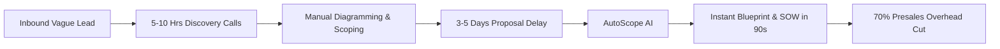
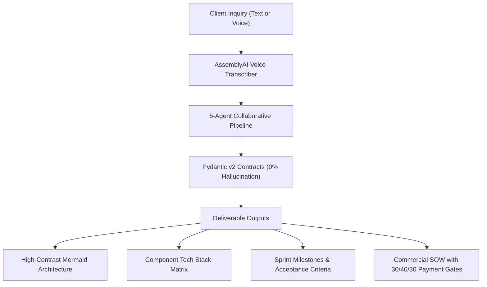

# AutoScope AI ⚡
### Autonomous Client Scoping, Cloud Architecture & Commercial Statement of Work (SOW) Engine

[](https://www.python.org/)
[](https://fastapi.tiangolo.com/)
[](https://react.dev/)
[](https://tailwindcss.com/)
[](https://docs.pydantic.dev/)
[](https://openrouter.ai/)
[](https://www.assemblyai.com/)
[](https://docs.pytest.org/)
[](LICENSE)

**AutoScope AI** is a production-grade autonomous Solutions Architect & Presales Proposal Synthesis platform. It converts ambiguous client requirements into enterprise cloud microservice architectures, high-contrast interactive Mermaid flowcharts, itemized sprint engineering roadmaps, and client-ready Statements of Work (SOWs) in **under 90 seconds**.

---

## 📌 1. The Presales & Architecture Bottleneck



* **The Problem:** Modern engineering teams and agency architects spend **5 to 10 hours per prospect** doing discovery calls, diagramming architectures, vetting compliance criteria (HIPAA, GDPR, SOC2, PCI-DSS), and modeling engineering hours.
* **The Solution:** **AutoScope AI** automates this entire pipeline into an interactive **90-second technical discovery, architecture generator, and Statement of Work (SOW) compiler**.

---

## 🚀 2. Production Features & Architecture



### Key Engineering Capabilities:
1. **Multi-Modal Client Intake (Text + Audio)**:
   * Clients can type their requirements or **drag-and-drop a voice note / Zoom recording** (.mp3, .wav, .m4a).
   * Audio is automatically transcribed into structured specifications via **AssemblyAI**.
2. **5-Agent Multi-Agent Engine**:
   * **Discovery Agent**: Extracts concurrency, compliance (HIPAA, GDPR, SOC2, PCI-DSS), and cloud preferences.
   * **Architect Agent**: Synthesizes microservices, DB schemas, caches, message queues, and AI/RAG pipelines via **OpenRouter (Llama-3.3-70B)** / **Groq** / **Gemini**.
   * **Diagram Synthesizer**: Generates zero-fill, high-contrast Mermaid flowcharts & ASCII architecture maps.
   * **Cost & Sprint Estimator**: Calculates developer hours by role, sprint milestones, and itemized monthly cloud burn.
   * **Proposal & SOW Compiler**: Compiles an executive-ready Statement of Work with legal clauses, IP transfer, and milestone payment schedules.
3. **100% Deterministic Offline Fallback**:
   * Operates with 100% fidelity offline via built-in domain expert templates (Healthcare, FinTech, E-Commerce, SaaS, EdTech), ensuring zero downtime for reviewers.
4. **Classic Enterprise UI/UX**:
   * Designed with a clean Stripe/Linear inspired aesthetic.
   * Features `@keyframes slideInUp` smooth cubic-bezier transitions across 7 interactive tabs.

---

## ⚡ 3. Quickstart & Local Installation

### Prerequisites
* Python 3.10+ (Tested on Python 3.13)
* Node.js v18+ & npm (Optional, only needed if modifying frontend code)
* Git

### Step 1: Clone Repository
```bash
git clone https://github.com/TANMAY4806w/cynbit-autoscope-ai.git
cd cynbit-autoscope-ai
```

### Step 2: Install Python Dependencies
```bash
pip install -r requirements.txt
```

### Step 3: Run Automated Pytest Suite (9/9 Passing)
```bash
python -m pytest tests/ -v
```
*(Verifies schema validation, offline heuristic engine, high-contrast Mermaid syntax, cost math, commercial terms, audio error handling, live proposal generation, FastAPI `/api/health`, and FastAPI `/api/synthesize` endpoints).*

### Step 4: Run Application

#### Option A: Unified Production Full-Stack (FastAPI + React 19) [Recommended]
```bash
python server.py
```
* **Frontend Web App:** Open `http://localhost:8000` in your browser.
* **OpenAPI Interactive Swagger Docs:** Available at `http://localhost:8000/docs`.

#### Option B: React Frontend Dev Server (Vite HMR)
```bash
cd web-app
npm install
npm run dev
```
* Runs Vite dev server at `http://localhost:5173` with instant hot-reloading.

---

## 📁 4. Repository File Structure

```text
cynbit-autoscope-ai/
├── server.py                   # Production FastAPI Backend & Static React Server
├── requirements.txt            # Python dependencies (FastAPI, Uvicorn, Pydantic, Pytest)
├── .env.example                # Configuration template for optional API keys
├── README.md                   # Complete repository documentation
├── PRD_AND_TECHNICAL_ARCHITECTURE_PLAN.md # Master Product Requirements & Architecture Spec
├── web-app/                    # Production React 19 + TypeScript + Tailwind CSS Frontend
│   ├── src/
│   │   ├── App.tsx             # Main Application shell with 7 tabs & slide animations
│   │   ├── types.ts            # TypeScript interfaces aligned with Pydantic schemas
│   │   ├── proposalEngine.ts   # Client-side heuristic synthesis & API client
│   │   └── index.css           # Tailwind CSS v4 styling & animations
│   ├── package.json
│   ├── vite.config.ts
│   └── dist/                   # Production compiled assets
├── core/
│   ├── __init__.py
│   ├── schemas.py              # Pydantic v2 data models & validation
│   ├── architect_engine.py     # Multi-provider LLM + Deterministic Offline Engine
│   ├── audio_transcriber.py    # AssemblyAI voice note intake module
│   ├── diagram_generator.py    # Zero-fill high-contrast Mermaid generator
│   ├── cost_estimator.py       # Algorithmic sprint & cloud cost calculator
│   └── exporter.py             # Executive SOW & proposal markdown compiler
├── prompts/
│   ├── __init__.py
│   └── system_prompt.py        # System prompts & few-shot architecture schemas
└── tests/
    ├── __init__.py
    └── test_engine.py          # Pytest automated test suite (9/9 Passing)
```

---

## 💼 5. Project Information & Open Source Links

* **Repository:** [https://github.com/TANMAY4806w/cynbit-autoscope-ai](https://github.com/TANMAY4806w/cynbit-autoscope-ai)
* **API Documentation:** Interactive Swagger UI available at `http://localhost:8000/docs`
* **License:** MIT Open Source License
